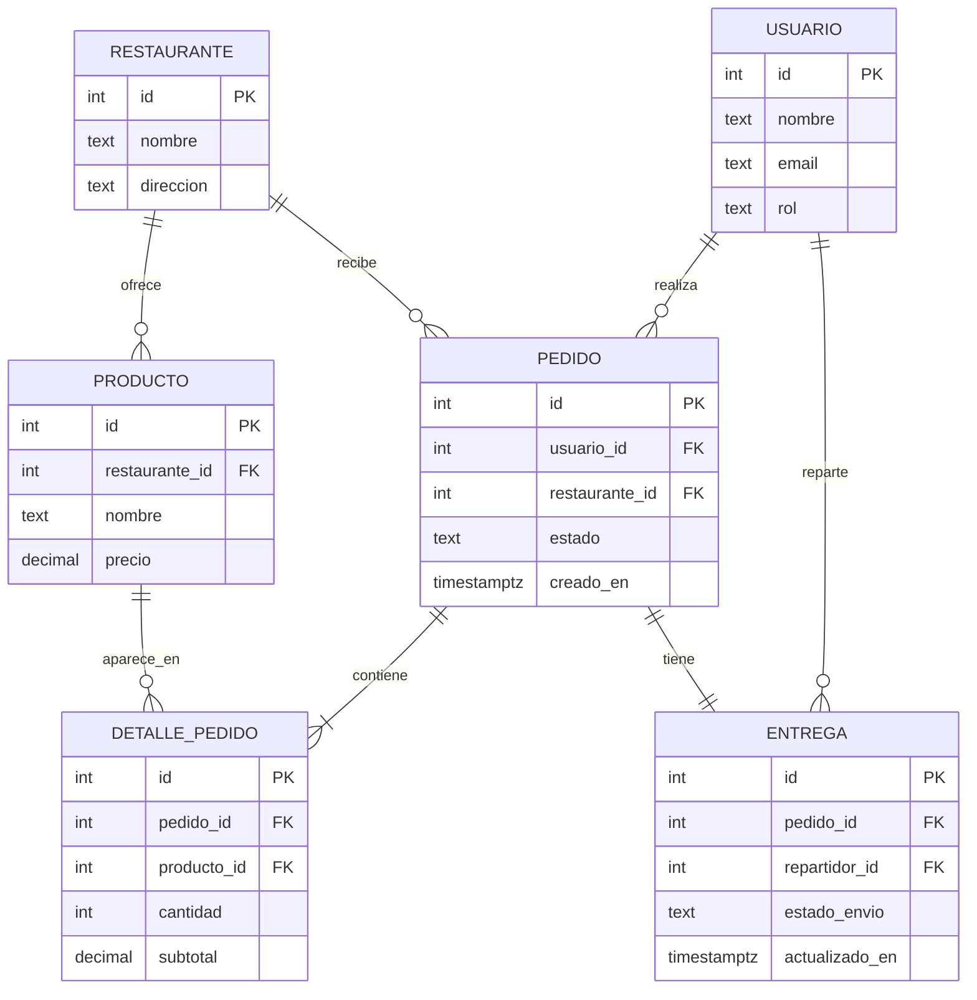

# PRD · Pedidos de comida a domicilio
> Documento de requisitos del producto (Product Requirements Document).
> Complétalo en el Sprint 0 (historia H0.3) y pide la aprobación del profesor en un Issue.
> Cada requisito funcional (RF) se convierte en un Issue con la plantilla "Historia de usuario".

| Campo | Valor |
| --- | --- |
| Alumno |Yetceangely| 
| Proyecto n.º |5|
| Sitio de referencia |Pedidos ya|
| Compañero revisor |dashiell |
| URL desplegada | (se completa en el Sprint 5) |

## 1. Problema

Los usuarios enfrentan demoras y falta de información al pedir comida causando una gran incertidumbre

## 2. Usuarios

- **Usuario principal:** cliente que busca rápida desde el móvil
- **Usuario secundario:** los repartidores 

## 3. Objetivo y métrica de éxito
busca completar pedidos eficientemente con actualizaciones en tiempo real

## 4. Alcance del MVP
1.registro de usuarios 
2.catalogo de restaurantes 
3.carrito de compras 
4.gestión de pedidos 
5.seguimiento real con SSE
6. historial de pedidos
7.asignación de repartidores 

### Funcionalidades → carpetas de `src/` (screaming architecture)

Cada funcionalidad del alcance será una carpeta en `src/`. Nómbralas en inglés y en plural.

| Funcionalidad | Carpeta |
| --- | --- |
| Users | src/users |
| Restaurants | src/restaurants |
| Carts | src/carts |
| Orders | src/orders |
| Tracking | src/tracking |
| Histories | src/histories |
| Deliveries | src/deliveries |

## 5. Fuera de alcance
- reseñas de restaurantes
- pasarela de pagos directa
- chat en vivo entre el cliente y el repartidor

## 6. Requisitos funcionales

| ID | Requisito | Prioridad (alta, media, baja) |
| --- | --- | --- |
| RF01 | Registro de usuarios | Alta |
| RF02 | Gestión de catálogo | Alta |

## 7. Requisitos no funcionales

- Responsive, móvil primero (375 px y 1280 px).
- Lighthouse ≥ 90 en Accesibilidad y Buenas prácticas.
- 0 errores en la consola del navegador.
- Funciona con 10.000 registros sin congelarse.

## 8. Modelo de datos

Diagrama entidad-relación y tablas PostgreSQL con tipos, claves y restricciones.
GitHub dibuja diagramas Mermaid;

## 9. Reto técnico distintivo

Cola de prioridad de pedidos más seguimiento en vivo con SSE,implementaré una cola con prioridad en Redis para ordenar los pedidos según su urgencia. Para el seguimiento en vivo, mantendré una conexión abierta con Server Sent Events SSE, enviando notificaciones automáticas del cambio de estado al cliente.

## 10. Riesgos y preguntas abiertas

Un riesgo principal es la desconexión de las conexiones SSE, lo que causaría pérdida de actualizaciones en tiempo real. ¿cómo manejaremos la reconexión automática sin sobrecargar el servidor?
